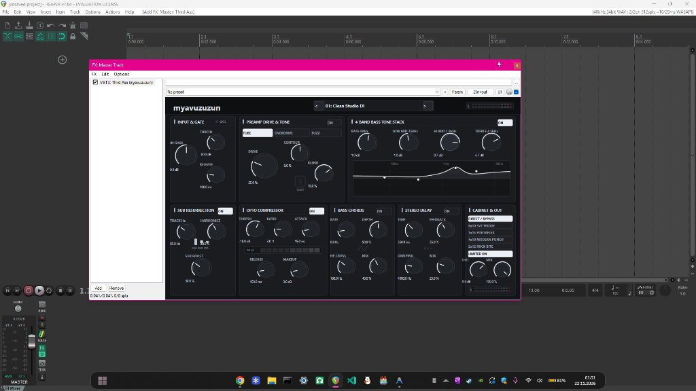

# Third Ass audio plugin

64-bit bass amplifier simulator and multi-effects processor for electric bass guitars, synth basses, and low-end sound design. 

inspired by 3rd Bass plugin by Fretted Synth.



built on open-source architectures providing dual output formats:
- **VeSTige**: native 64-bit DLL for LMMS (VeSTige) and Windows DAWs.
- **VST3**: modern VST3 format (`.vst3` bundle) for modern DAWs (Cubase, REAPER, Ableton Live, Studio One, FL Studio, Bitwig) without requiring bridges, wrappers, or proprietary SDK dependencies.

## gui

rendered on Windows via hardware-accelerated **Direct2D & DirectWrite**:

- **contextual signal-flow grouping**: modules are grouped strictly by studio audio signal chain (Input/Gate -> Preamp & Drive -> 4-Band EQ on top row; Sub Resurrection -> Opto Compressor -> Crossover Chorus -> Stereo Delay -> Cabinet & Master on bottom row).
- **dynamic 4-band eq visualizer**: recessed graphical spectrum analyzer showing real-time composite frequency curves across 20 Hz – 20 kHz with draggable frequency node markers.
- **tube filament glow & visualizers**: 12AX7 vacuum tube visualizer glows dynamically with Drive level; Crossover Chorus wave and Stereo Delay decay representations.
- **real-time LED metering**:
  - Live Noise Gate status LED (`OPEN` vs `GATE`).
  - Opto Compressor Gain Reduction LED meter (`GR dB` ladder from 0 to -18 dB).
  - Stereo Master Output Peak VU meter with clip indication.
- **controls**:
  - **vertical drag**: smooth adjustment across parameter ranges.
  - **shift + drag**: 10x fine-tuning precision.
  - **mouse wheel scroll**: turn any knob by scrolling up or down.
  - **double click**: instantly reset any knob to its factory default value.
  - **presets**: `<` and `>` quick navigation through all 12 factory presets.
  - **Bypass / Toggle buttons**: ON/OFF toggle per module with glowing illuminated states.

---

## features & signal chain

1. **Input Stage & Noise Gate**
   - clean adjustable threshold (`-90 dB` to `0 dB`) and exponential release (`10 ms` to `500 ms`) to silence high-gain amplifier buzz, single-coil hum, and idle line noise.
2. **Preamp Drive & Saturation**
   - **Warm Tube**: asymmetrical triode-style soft saturation with tube warmth and DC blocking.
   - **Overdrive**: pushed symmetrical solid-state/tube crunch.
   - **Fuzz / Heavy Grit**: aggressive clipping for modern distorted bass riffs.
   - **Tone / Pre-tilt Control**: tightens the low-end contour before saturation.
   - **Drive Mix**: blend parallel clean bass underneath the drive so you never lose the fundamental low-end punch.
3. **4-Band EQ**
   - **Bass (80 Hz)**: low shelving filter (+/- 15 dB) for foundational weight.
   - **Low Mid (350 Hz)**: peaking bell filter (+/- 15 dB) for body and warmth.
   - **High Mid (1.8 kHz)**: peaking bell filter (+/- 15 dB) for finger pluck, pick attack, and growl.
   - **Treble (4.5 kHz)**: high shelving filter (+/- 15 dB) for string zing and modern clarity.
4. **Resurrection Psychoacoustic Sub-Harmonic Enhancer**
   - signature sub-bass generator inspired by Christian Budde's Resurrection DSP.
   - tunable fundamental tracking frequency (`40 Hz` to `120 Hz`).
   - generates non-linear 2nd & 3rd virtual pitch harmonics that fool the human ear into hearing deep sub-bass on small monitors, laptops, and headphones.
   - Sub Boost control adds sub-octave rumble.
5. **Bass Dynamics (Opto / Soft-Knee Compressor)**
   - Threshold (`-40 dB` to `0 dB`), Ratio (`1:1` to `12:1`), Attack (`1 ms` to `100 ms`), Release (`20 ms` to `1000 ms`), and Makeup Gain (`0 dB` to `24 dB`).
   - Smooth 4 dB soft-knee characteristic to even out dynamic slap spikes and fingerstyle variations.
6. **Bass Crossover Stereo Chorus**
   - integrated Linkwitz-Riley 2nd-order crossover filter (default `180 Hz`).
   - **Sub-lows stay 100% mono, tight, and unmodulated** in the center (avoiding phase cancellation in the low end).
   - low-mids, mids, and highs receive lush dual quadrature stereo LFO modulation (Left 0°, Right 90°).
7. **Stereo Analog / Tape Delay**
   - up to 1000 ms stereo delay line with ping-pong stereo offset.
   - 1-pole high-cut damping filter (`1 kHz` to `16 kHz`) for vintage warm repeats.
8. **Speaker Cabinet Simulation**
   - **0: Direct / Bypass**: clean studio DI sound.
   - **1: Classic 8x10 SVT Fridge**: standard punchy Ampeg-style rock cabinet with 2.4 kHz upper-mid punch and 4.5 kHz speaker roll-off.
   - **2: Vintage 1x15 Portaflex**: deep, round vintage Motown / reggae warmth with smooth rolled-off highs.
   - **3: Modern 4x10 Punch**: fast transient response, scooped 500 Hz boxiness, and crisp horn extension up to 6.2 kHz.
   - **4: Aggressive 2x12 Rock**: cutting 1.1 kHz - 2.6 kHz mid bite for heavy rock and metal pick bass.
9. **Master & Brickwall Peak Limiter**
   - zero-latency soft-knee peak limiter ceiling at `-0.1 dBFS` prevents digital clipping.
   - master volume and total Dry/Wet mix.

---

## 12 Factory Presets

1. **01: Clean Studio DI** - clean studio DI with gentle opto compression.
2. **02: Vintage Tube Warmth** - warm tube preamp drive through a 1x15 Portaflex cabinet.
3. **03: 8x10 Rock Growl** - punchy SVT 8x10 rock growl with mid bite.
4. **04: Funky Slap & Pop** - scooped mids, boosted 80 Hz bass and 4.5 kHz treble with subtle chorus.
5. **05: Sub Heavy Dub** - deep sub-harmonic resurrection with 1x15 low-end rumble.
6. **06: Motown 1x15 Soul** - round, warm vintage bass with rolled-off treble.
7. **07: Modern Punch & Snap** - modern bass tone for versatile pop/rock mixes.
8. **08: Gritty Overdrive** - saturated pushed overdrive with parallel dry blend.
9. **09: Fuzz Bass Monster** - heavy fuzz saturation through 2x12 rock cab.
10. **10: 80s Chorus Bass** - lush stereo chorus with clean mono sub-bass.
11. **11: Ambient Space Bass** - atmospheric chorus and tape delay wash.
12. **12: Tight Metal Pick** - fast noise gate, aggressive 2x12 cabinet, and cutting high-mid attack.

---

## installation

### 1. building on Windows
run the automated build script in PowerShell:
```powershell
.\build.ps1 -Install
```
Or via make:
```bash
make
make install
```

### 2. formats & paths
* **VeSTige 64-bit audio plugin**: `dist\ThirdAss.dll` (optimized for LMMS VeSTige)
* **modern VST3 plugin**: `dist\ThirdAss.vst3` (for modern DAWs: Cubase, REAPER, FL Studio, Ableton, Studio One)
* **LMMS VeSTige path**: `%USERPROFILE%\Documents\lmms\plugins\vst\ThirdAss.dll`
* **Common VST3 path**: `%LOCALAPPDATA%\Programs\Common\VST3\ThirdAss.vst3`
* **Common VST path**: `C:\Users\%USERNAME%\Documents\VstPlugins\ThirdAss.dll` & `ThirdAss.vst3`
* **standalone gui preview**: `bin\thirdass_gui.exe`

---

## Running Verification Tests

To run the automated verification suite:
```powershell
powershell -ExecutionPolicy Bypass -File .\test_vst.ps1
```

---

## License

ISC License (Open-source, permissive).
Designed & built by myavuzuzun.
- **`include/vestige/vestige.h`**: VeSTige compatibility header (GNU GPL v2 or later, originally by Javier Serrano Polo; sourced from Carla/LMMS).
- **`include/vst3.h`** & **`include/vst3_plugin.h`**: Open-source GPLv3 VST3 headers (derived from Steinberg VST3 SDK under GPLv3 and `vst3_plugin` by Tor-Helge Skei under GPLv3).
- *VST is a trademark of Steinberg Media Technologies GmbH, registered in Europe and other countries.*